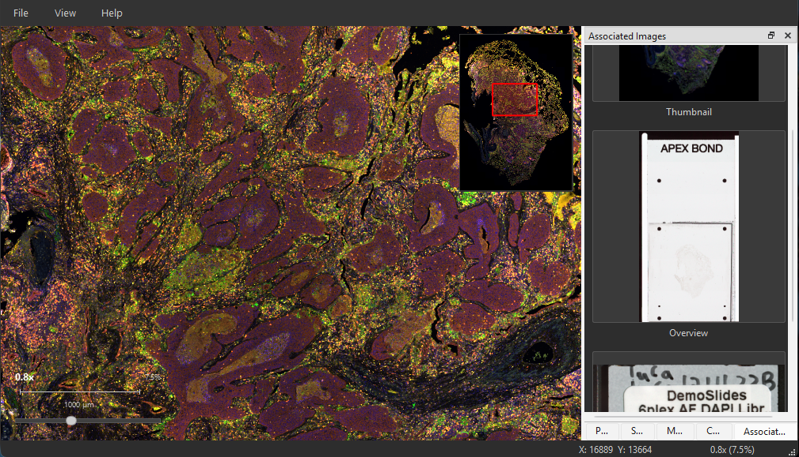

# SlideIO Viewer

A cross-platform C++ desktop application for viewing and navigating digital pathology whole-slide images (WSI).

SlideIO Viewer renders gigapixel-scale slide images with smooth pan and zoom using GPU-accelerated tile rendering. It supports all major pathology slide formats through the [SlideIO](https://github.com/Booritas/slideio) library.



## Supported Formats

SVS, AFI, NDPI, SCN, CZI, ZVI, VSI, MRXS, BIF, LIF, ND2, QPTIFF, OME-TIFF, Philips TIFF, DICOM WSI, and TIFF/BigTIFF, PNG and JPEG — every format the SlideIO library supports.

## Features

- GPU-accelerated tile rendering (OpenGL 3.3+)
- Multi-resolution pyramid navigation with async tile loading
- LRU tile cache with configurable memory budget
- Minimap overview, zoom indicator and scale bar
- Colour management through embedded, default or per-slide ICC profiles
- Channel mixer with per-channel histograms, and Z-stack and time-series navigation
- Annotations: rectangle, ellipse, polygon, freehand line, point marker, arrow,
  text, ruler and angle, saved automatically per slide and scene, with undo and redo
- Annotation layers, categorized counting and measurements in microns, with a
  per-scene calibration override
- Export of counts and measurements as CSV and of annotations as GeoJSON;
  import from GeoJSON (including QuPath) and ASAP XML
- Drag-and-drop file opening
- Recent files menu
- Dark theme UI

## Requirements

- C++17 compiler (MSVC 2022, GCC 12+, or AppleClang 14+)
- CMake 3.20+
- Conan 2 package manager
- Python 3 (drives the SlideIO submodule build)
- Qt 6.5+
- OpenGL 3.3+ capable GPU

SlideIO is not a separate prerequisite: it ships as a git submodule under
`extern/slideio` and is built from source. On Windows, run the build from a
Visual Studio developer command prompt so the SlideIO build can find `cl.exe`.

## Building

### 1. Clone with submodules

```bash
git clone --recurse-submodules https://github.com/Booritas/slideio-view.git
```

In a clone that already exists:

```bash
git submodule update --init --recursive
```

### 2. Build

```bash
./build.sh          # Release
./build-debug.sh    # Debug
```

Each script builds the SlideIO submodule into `extern/slideio/build/install`,
then configures, builds, and installs the viewer. SlideIO is rebuilt only when
that install tree is missing; set `SLIDEIO_REBUILD=1` to force it, for instance
after moving the submodule to a new revision.

To link against a SlideIO install maintained outside this repository, set
`SLIDEIO_ROOT`. The submodule is then neither built nor needed:

```bash
SLIDEIO_ROOT=/path/to/slideio/install ./build.sh
```

### 3. Run tests

```bash
cd build/build
ctest --output-on-failure -C Release
```

### Building step by step

The scripts are thin wrappers around these commands:

```bash
# SlideIO, once per configuration
cd extern/slideio
python3 install.py -a install -c release -bd build/build -pr build/install
cd ../..

conan install . --output-folder=build --build=missing -s build_type=Release -s compiler.cppstd=17

cmake -S . -B build/build -G "Visual Studio 17 2022" \
  -DCMAKE_TOOLCHAIN_FILE=build/build/generators/conan_toolchain.cmake \
  -DCMAKE_POLICY_DEFAULT_CMP0091=NEW

cmake --build build/build --config Release
```

On Linux/macOS, substitute `-G Ninja` and drop the policy flag.

`SLIDEIO_ROOT` defaults to `extern/slideio/build/install` and must hold
`release/` and `debug/` subdirectories of SlideIO headers, libraries, and DLLs.
A debug build of the viewer needs both: the release library is required in every
configuration, and the debug one is added on top of it.

## Installation

### Install to a directory

```bash
cmake --install build/build --config Release --prefix "path/to/install"
```

This produces a self-contained directory with the executable, all required DLLs (Qt, SlideIO), and Qt plugins. No environment setup needed.

### Build a distributable package

```bash
cd build/build
cpack -G ZIP -C Release    # Portable ZIP archive
cpack -G NSIS -C Release   # Windows installer (requires NSIS)
```

## Usage

```bash
slideio-viewer                          # Launch empty
slideio-viewer path/to/slide.svs        # Open a slide directly
```

### Navigation

| Input | Action |
|-------|--------|
| Scroll wheel | Zoom toward cursor |
| Left-click drag | Pan |
| Arrow keys | Pan (20px per press) |
| Ctrl+0 | Fit to window |
| Ctrl+1 | Actual pixels (1:1) |
| Ctrl++ / Ctrl+- | Zoom in / out |
| F11 | Full screen |
| Ctrl+M | Toggle minimap |

### File operations

| Shortcut | Action |
|----------|--------|
| Ctrl+O | Open slide |
| Ctrl+W | Close slide |
| Drag & drop | Open dropped file |

## Project Structure

```
src/
  core/     Pure C++17 domain layer (no Qt)
  app/      Application services: annotation model, persistence, undo/redo
  infra/    SlideIO adapter, tile cache, tile scheduler, annotation repository
  ui/       Qt widgets, OpenGL rendering, main window
  main.cpp  Entry point
tests/
  core/     Unit tests for the domain layer
  app/      Unit tests for the application services
  infra/    Unit tests for the infrastructure layer
  ui/       Unit tests for the UI layer's pure logic
extern/
  slideio/  SlideIO library (git submodule)
```

The project uses a layered architecture with strict downward dependencies enforced at the CMake level. See [CLAUDE.md](CLAUDE.md) for architecture details.

## License

BSD 3-Clause License. See [LICENSE](LICENSE).
